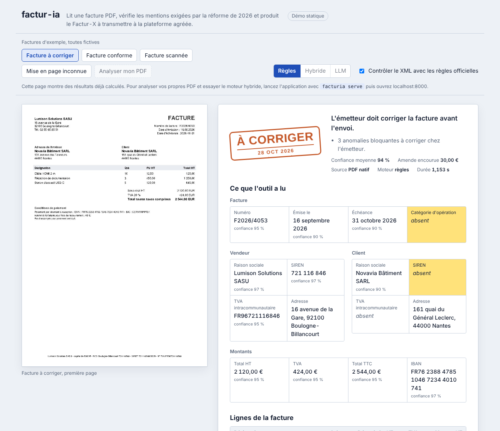
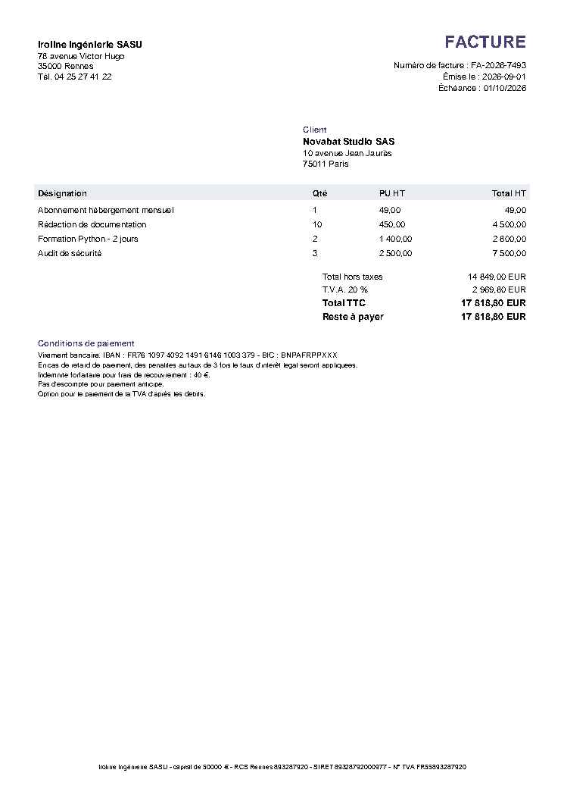

# factur-ia

[](https://github.com/melissa-bouamama/facture_ai/actions/workflows/ci.yml)


**Transformer une facture PDF, native ou scannée, en facture électronique Factur-X conforme EN 16931, et dire précisément ce qui manque avant qu'une plateforme agréée ne la rejette.**

> *In English. Document AI pipeline for the French 2026 electronic invoicing mandate: extraction guided by the page layout (rules, OCR and an optional local LLM with grounding checks), validation against EN 16931 and the official French BR-FR schematron, routing by confidence (ready, fix, human review) and Factur-X generation. Evaluated on a reproducible synthetic benchmark, including an unseen layout to measure silent failures.*

## Démo

**[Ouvrir la démo en ligne](https://melissa-bouamama.github.io/facture_ai/demo/)** (résultats précalculés), ou lancer l'application complète en local avec `facturia serve` puis ouvrir `http://localhost:8000`.

<p align="center">
  
</p>

L'interface montre la facture lue, la décision sous forme de tampon, chaque champ extrait avec sa confiance, les mentions manquantes surlignées et le résultat des contrôles officiels du XML. En local, elle analyse aussi vos propres PDF, permet de passer du moteur à règles au moteur hybride et télécharge le Factur-X produit.

## Le problème

Depuis le **1er septembre 2026**, toutes les entreprises françaises doivent pouvoir **recevoir** des factures électroniques. Au **1er septembre 2027**, les **PME, TPE et micro-entreprises** devront aussi en **émettre**. Un PDF envoyé par courriel ne sera plus une facture valable : il faut un format structuré (UBL, CII) ou hybride (**Factur-X**), transmis par une plateforme agréée.

* Avant la réforme, **58 %** des entreprises concernées facturaient en PDF et **83 %** n'utilisaient aucun format requis.
* Un mois après le lancement, **20 millions** de factures avaient été échangées, mais **un quart** des entreprises n'avait pas encore désigné de plateforme.
* La réforme ajoute **4 mentions obligatoires** : SIREN du client, catégorie d'opération, adresse de livraison et option pour la TVA sur les débits. Chaque mention manquante coûte **15 €**, et une donnée absente du XML fait **rejeter** la facture.

Une grande partie des PME va donc devoir passer, en moins d'un an, de « je génère un PDF depuis Word » à « j'émets un XML conforme ». Les cabinets comptables, eux, continueront de recevoir des PDF et des scans pour tous les flux hors réforme.

**Analyse complète, chiffres et sources : [docs/marche.md](docs/marche.md)**

## Ce que fait factur-ia

1. **Lit** le PDF : texte natif, ou **OCR** après redressement automatique du scan, avec deux moteurs au choix : Tesseract ou docTR (réseaux de neurones, 100 % Python).
2. **Reconstruit la mise en page** (lignes, colonnes, cellules) pour ne pas mélanger le bloc du vendeur et celui du client.
3. **Extrait** les données au format EN 16931 avec trois moteurs au choix :
   * **règles** : déterministe et explicable, environ 40 ms par facture native.
   * **LLM** : n'importe quel modèle compatible avec l'API OpenAI, **local par défaut** (Ollama, vLLM) pour que les factures ne quittent pas l'entreprise.
   * **hybride** : les règles d'abord, le LLM **seulement en cas de doute** pour maîtriser le coût, avec une fusion champ par champ.
4. **Refuse les hallucinations** : un SIREN, un IBAN ou un montant renvoyé par le LLM n'est gardé que s'il passe sa clé de contrôle **et** figure réellement dans le document.
5. **Contrôle la conformité** avec 36 règles reliées aux champs EN 16931 (BT, BG) et aux règles françaises BR-FR, propose une correction et estime l'amende encourue. Un client particulier n'est pas soumis aux obligations réservées aux entreprises.
6. **Décide** : prête à émettre, à corriger chez l'émetteur, ou à relire par une personne quand la lecture est incertaine.
7. **Génère** le XML CII et le PDF Factur-X, validés par le **XSD officiel** et les **schematrons EN 16931 et BR-FR**.

<p align="center">
  
  &nbsp;
  
</p>

## Résultats

Benchmark reproductible (`python bench/benchmark.py`) sur des factures synthétiques avec vérité terrain. Détail et limites dans **[docs/evaluation.md](docs/evaluation.md)**.

> Chiffres mesurés avec le moteur OCR Tesseract. La comparaison avec docTR est dans [docs/evaluation.md](docs/evaluation.md).

| | Gabarits connus (200 factures, 30 % scannées) | Gabarit inconnu (60 factures) |
|---|---|---|
| Factures extraites sans aucune erreur sur 15 champs | **99,0 %** | 0 % |
| Détection des mentions obligatoires manquantes | précision et rappel de **100 %** sur les 6 anomalies suivies | rappel de 100 %, précision faible car la lecture échoue |
| Factures fausses validées en silence | **2 sur 200**, des erreurs de caractères OCR sur un nom | **0 sur 60**, toutes envoyées en revue |
| Latence médiane (CPU, 2 cœurs) | 40 ms pour un PDF natif, 2,6 s pour un scan | identique |

Le second jeu utilise une mise en page et un vocabulaire **jamais vus** par les règles (« Réf. », « À l'attention de », « Base HT »). Les règles s'y effondrent, comme prévu : c'est le rôle du moteur hybride. Mais **aucune facture fausse n'est validée en silence**, toutes partent en revue. Pour un outil comptable, savoir dire « je ne sais pas » compte autant que l'exactitude.

## Démarrage rapide

```bash
git clone https://github.com/melissa-bouamama/facture_ai.git && cd facture_ai

python3 -m venv venv && source venv/bin/activate   # évite l'erreur « externally managed environment »
pip install -e ".[ocr,api,schematron,bench]"    # OCR : docTR inclus, Tesseract utilisé s'il est installé

facturia serve                                  # interface sur http://localhost:8000
facturia analyze examples/corriger.pdf          # rapport de conformité dans le terminal
facturia convert examples/conforme.pdf          # écrit conforme.facturx.pdf et conforme.facturx.xml
facturia generate data/demo --n 20              # jeu synthétique annoté
facturia evaluate data/demo                     # métriques
```

Avec Docker, `docker compose up` démarre l'interface, l'API et un LLM local Ollama.

### Avec un LLM local

```bash
ollama pull qwen2.5:7b-instruct
export FACTURIA_LLM_BASE_URL=http://localhost:11434/v1 FACTURIA_LLM_MODEL=qwen2.5:7b-instruct
facturia analyze facture.pdf --backend hybrid
python bench/benchmark.py --backend hybrid
```

Toute API compatible OpenAI fonctionne, avec `FACTURIA_LLM_API_KEY` pour un service hébergé.

### API

```bash
curl -F file=@examples/corriger.pdf "http://localhost:8000/v1/analyze?schematron=true"
curl -F file=@examples/conforme.pdf http://localhost:8000/v1/convert -o facturx.pdf
```

La documentation interactive est sur `http://localhost:8000/docs`. La conversion répond avec le code 422 et la liste des anomalies quand la facture n'est pas prête.

### En Python

```python
from facturia import process

result = process("facture.pdf", extractor="hybrid", facturx=True, schematron=True)
print(result.report.decision, [i.message for i in result.report.errors])
open("facture.facturx.pdf", "wb").write(result.facturx_pdf)
```

## Architecture


Les modules et les choix sont détaillés dans **[docs/architecture.md](docs/architecture.md)**, la correspondance avec les règles officielles dans **[docs/conformite.md](docs/conformite.md)**.

## Choix techniques

| Choix | Pourquoi |
|---|---|
| Règles d'abord, LLM en second | Sur les mises en page connues, les règles sont exactes, explicables et gratuites. Le LLM ne coûte du temps ou de l'argent que sur les cas difficiles. |
| Ancrage des sorties du LLM | En finance, une valeur inventée est pire qu'une valeur manquante. Tout identifiant ou montant doit apparaître dans le document. |
| Clés de contrôle partout | Luhn pour le SIREN et le SIRET, clé de TVA, mod 97 pour l'IBAN. Elles valident la facture et corrigent l'OCR (O lu à la place de 0, l à la place de 1) sans risque. |
| Schematrons officiels exécutés en Python | Le XML est vérifié par les mêmes règles BR-FR que celles des plateformes, avec SaxonC-HE et sans serveur Java. |
| Deux moteurs OCR, comparés sur le même benchmark | Tesseract est le plus exact sur les scans du benchmark (96,7 % de factures entièrement justes, contre 45,9 % pour docTR dans sa version légère, qui perd les tirets isolés et ne connaît pas « œ »). docTR s'installe entièrement en Python, sans binaire système. `FACTURIA_OCR=tesseract`, `doctr` ou `auto`, le moteur utilisé figure dans le rapport. |
| Décision à trois états | Une incohérence peut venir de la facture ou de l'OCR. Dans le doute, une personne tranche. La métrique suivie est le nombre d'erreurs **silencieuses**. |
| LLM local par défaut | Les factures contiennent des données sensibles (secret des affaires, RGPD). L'inférence reste dans l'infrastructure. |
| Données synthétiques et jeu inconnu | Il n'existe pas de base publique de factures françaises annotées. Le générateur rend le benchmark reproductible, et le gabarit inconnu empêche de se raconter des histoires. |

## Limites et feuille de route

* **Évaluation synthétique** : les règles ont été écrites en voyant les 4 gabarits connus. Seul le gabarit inconnu mesure la généralisation. Prochaine étape : un jeu réel anonymisé et annoté, dont le format d'évaluation est déjà prévu (`facturia evaluate`).
* **Benchmark LLM** : le moteur hybride est testé avec un LLM simulé (fusion, ancrage, pannes). Ses chiffres sur un vrai modèle se reproduisent avec l'option `--backend hybrid`.
* Profil **EN 16931** uniquement, sans avoirs complexes, remises ou frais au niveau du document, et avec une seule devise.
* PDF/A-3 strict non garanti, car il dépend du PDF source. À valider avec veraPDF avant la production.
* Pistes : un modèle de mise en page entraîné (LayoutLMv3, Donut) à la place des règles, la détection de doublons et de fraude à l'IBAN, l'export UBL et un connecteur vers une plateforme agréée.

## Structure du dépôt

```
src/facturia/
├── reader.py         PDF vers mots positionnés (natif, ou OCR et redressement)
├── extract/
│   ├── rules.py      extraction guidée par la mise en page
│   ├── llm.py        LLM compatible OpenAI, sortie contrainte, ancrage
│   └── hybrid.py     escalade conditionnelle et fusion
├── validate.py       36 contrôles EN 16931, BR-FR et réforme 2026
├── export/           XML CII, schematrons, PDF Factur-X
├── pipeline.py       de bout en bout, avec la décision
├── api.py            API FastAPI et interface de démo
├── web/demo.html     interface de démo
├── cli.py            ligne de commande
├── synth.py          générateur de factures avec vérité terrain
└── evaluate.py       métriques
bench/                benchmark reproductible et résultats
examples/             PDF d'entrée, rapports JSON, Factur-X produits
docs/                 marché, architecture, conformité, évaluation, démo en ligne
tests/                59 tests, dont les schematrons officiels, un LLM simulé et une mise en page de facture réelle
```

## Licence

MIT, voir [LICENSE](LICENSE). Toutes les entreprises et tous les identifiants des exemples sont fictifs.

Projet réalisé par **Melissa Bouamama**, ingénieure IA et data scientist.
