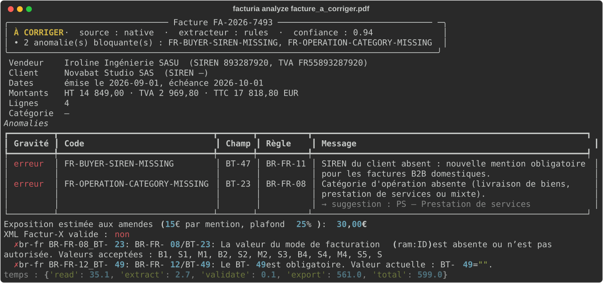
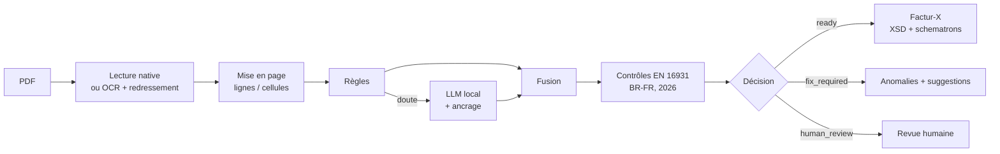

# factur-ia

[](https://github.com/melissa-bouamama/factur-ia/actions/workflows/ci.yml)


**Transformer une facture PDF — native ou scannée — en facture électronique Factur-X conforme EN 16931, et dire précisément ce qui manque avant qu'une plateforme agréée ne la rejette.**

> *English TL;DR — Document-AI pipeline for France's 2026 e-invoicing mandate: layout-aware extraction (rules + OCR + optional local LLM with grounding checks), validation against EN 16931 and the official French BR-FR schematron, confidence-based routing (ready / fix / human review), and Factur-X (PDF/XML CII) generation. Evaluated on a reproducible synthetic benchmark, including an out-of-distribution layout to measure silent failures.*

<p align="center">
  
  &nbsp;
  
</p>

---

## Le problème

Depuis le **1er septembre 2026**, toutes les entreprises françaises doivent pouvoir **recevoir** des factures électroniques ; au **1er septembre 2027**, les **PME, TPE et micro-entreprises** devront aussi en **émettre**. Un PDF envoyé par e-mail ne sera plus une facture valable : il faut un format structuré (UBL, CII) ou hybride (**Factur-X**), transmis par une plateforme agréée.

- Avant la réforme, **58 %** des entreprises concernées facturaient en PDF et **83 %** n'utilisaient aucun format requis.
- Un mois après le lancement, **20 millions** de factures avaient été échangées, mais **un quart** des entreprises n'avait pas encore désigné de plateforme.
- La réforme ajoute **4 mentions obligatoires** (SIREN du client, catégorie d'opération, adresse de livraison, option TVA sur les débits) ; chaque mention manquante coûte **15 €**, et une donnée absente du XML fait **rejeter** la facture.

Une grande partie des PME va donc devoir passer, en moins d'un an, de « je génère un PDF depuis Word » à « j'émets un XML conforme ». Les cabinets comptables, eux, continueront de recevoir des PDF et des scans pour tous les flux hors réforme.

**→ Analyse complète, chiffres et sources : [docs/marche.md](docs/marche.md)**

## Ce que fait factur-ia

1. **Lit** le PDF : texte natif, ou **OCR** (Tesseract français) après redressement automatique du scan.
2. **Reconstruit la mise en page** (lignes, colonnes, cellules) pour ne pas mélanger le bloc vendeur et le bloc client.
3. **Extrait** les données au format EN 16931 avec trois moteurs au choix :
   - `rules` : déterministe, explicable, ~35 ms par facture native ;
   - `llm` : n'importe quel LLM compatible OpenAI — **local par défaut** (Ollama, vLLM) pour que les factures ne quittent pas l'entreprise ;
   - `hybrid` : les règles d'abord, le LLM **seulement en cas de doute** (coût maîtrisé), avec fusion champ par champ.
4. **Refuse les hallucinations** : un SIREN, un IBAN ou un montant renvoyé par le LLM n'est conservé que s'il passe sa clé de contrôle **et** figure réellement dans le document.
5. **Contrôle la conformité** : 34 règles reliées aux champs EN 16931 (BT/BG) et aux règles françaises BR-FR, avec suggestion de correction et estimation de l'amende encourue.
6. **Décide** : `ready` (prête à émettre), `fix_required` (à corriger chez l'émetteur), `human_review` (lecture incertaine).
7. **Génère** le XML CII et le PDF Factur-X, validés contre le **XSD officiel** et les **schematrons EN 16931 et BR-FR**.

## Résultats

Benchmark reproductible (`python bench/run_benchmark.py`) sur des factures synthétiques avec vérité terrain — détail et limites dans **[docs/evaluation.md](docs/evaluation.md)**.

| | In-distribution (200 factures, 30 % scannées) | Hors gabarit (60 factures, mise en page inconnue) |
|---|---|---|
| Factures extraites sans aucune erreur (15 champs) | **99,0 %** | 0 % |
| Détection des mentions obligatoires manquantes | précision et rappel **100 %** sur les 6 anomalies suivies | rappel 100 %, précision faible (lecture ratée) |
| Factures fausses validées en silence | **2 / 200** (erreurs de caractères OCR sur un nom) | **0 / 60** — 100 % envoyées en revue |
| Latence médiane (CPU, 2 cœurs) | 37 ms natif · 2,6 s scanné | idem |

Le second jeu utilise une mise en page et un vocabulaire **jamais vus** par les règles (« Réf. », « À l'attention de », « Base HT »…). Les règles s'y effondrent — c'est attendu et c'est le rôle du mode `hybrid` — mais **aucune facture fausse n'est validée en silence** : toutes partent en revue. Pour un outil comptable, savoir dire « je ne sais pas » compte autant que l'exactitude.

## Démarrage rapide

```bash
git clone https://github.com/melissa-bouamama/factur-ia.git && cd factur-ia
pip install -e ".[ocr,api,schematron,bench]"     # + tesseract-ocr et tesseract-ocr-fra pour les scans

facturia analyze examples/facture_a_corriger.pdf          # rapport de conformité
facturia convert examples/facture_conforme.pdf            # → facture_conforme_facturx.pdf + .xml
facturia generate data/demo --n 20                        # jeu synthétique annoté
facturia evaluate data/demo                               # métriques
```

### Avec un LLM local (hybride)

```bash
ollama pull qwen2.5:7b-instruct
export FACTURIA_LLM_BASE_URL=http://localhost:11434/v1 FACTURIA_LLM_MODEL=qwen2.5:7b-instruct
facturia analyze facture.pdf --backend hybrid
python bench/run_benchmark.py --backend hybrid
```

Toute API compatible OpenAI fonctionne (`FACTURIA_LLM_API_KEY` pour une API hébergée).

### API

```bash
facturia serve                                   # ou : docker compose up
curl -F file=@examples/facture_a_corriger.pdf "http://localhost:8000/v1/analyze?schematron=true"
curl -F file=@examples/facture_conforme.pdf  http://localhost:8000/v1/convert -o facturx.pdf
```

Documentation interactive : `http://localhost:8000/docs`. `/v1/convert` répond `422` avec la liste des anomalies si la facture n'est pas prête.

### En Python

```python
from facturia import process

result = process("facture.pdf", extractor="hybrid", facturx=True, schematron=True)
print(result.report.decision, [i.code for i in result.report.errors])
open("facture_facturx.pdf", "wb").write(result.facturx_pdf)
```

## Architecture



Détails des modules et des choix : **[docs/architecture.md](docs/architecture.md)** · correspondance avec les règles officielles : **[docs/conformite.md](docs/conformite.md)**.

## Choix techniques

| Choix | Pourquoi |
|---|---|
| Règles d'abord, LLM en second | Sur les mises en page connues, les règles sont exactes, explicables et gratuites ; le LLM n'est payé (en temps ou en euros) que sur les cas difficiles. |
| Ancrage des sorties du LLM | En finance, une valeur inventée est pire qu'une valeur manquante. Tout identifiant ou montant doit apparaître dans le document. |
| Clés de contrôle partout | Luhn (SIREN/SIRET), clé TVA, mod 97 (IBAN) servent à la fois à valider la facture et à corriger l'OCR (O→0, l→1) sans risque. |
| Schematrons officiels exécutés en Python | La conformité n'est pas « ce que je crois » : le XML est vérifié par les mêmes règles BR-FR que celles des plateformes, via SaxonC-HE, sans serveur Java. |
| Décision à trois états | Une incohérence peut venir de la facture ou de l'OCR : dans le doute, un humain tranche. La métrique suivie est le nombre d'erreurs **silencieuses**. |
| LLM local par défaut | Données commerciales sensibles (secret des affaires, RGPD) : l'inférence reste dans l'infrastructure. |
| Données synthétiques + jeu hors distribution | Aucune base publique de factures françaises annotées ; le générateur permet un benchmark reproductible, et le jeu hors gabarit empêche de se raconter des histoires. |

## Limites et feuille de route

- **Évaluation synthétique** : les règles ont été écrites en voyant les 4 gabarits « in-distribution » ; seul le jeu hors gabarit mesure la généralisation. Prochaine étape : un jeu réel anonymisé annoté (le format d'évaluation est déjà prévu, voir `facturia evaluate`).
- **Benchmark LLM** : le mode hybride est testé avec un LLM simulé (fusion, ancrage, pannes) ; ses chiffres sur un vrai modèle se reproduisent avec `--backend hybrid`.
- Profil **EN 16931** uniquement (pas EXTENDED), pas d'avoirs complexes ni de remises/charges au niveau document, une seule devise.
- PDF/A-3 strict non garanti (dépend du PDF source) ; à valider avec veraPDF avant production.
- Pistes : modèle de mise en page entraîné (LayoutLMv3 / Donut) en remplacement des règles, détection de doublons et de fraude à l'IBAN, export UBL, connecteur vers une plateforme agréée.

## Structure du dépôt

```
src/facturia/
├── reader.py            PDF → mots positionnés (natif ou OCR + redressement)
├── extract/
│   ├── rules.py         extraction guidée par la mise en page
│   ├── llm.py           LLM compatible OpenAI, sortie contrainte, ancrage
│   └── hybrid.py        escalade conditionnelle et fusion
├── validate.py          34 contrôles EN 16931 / BR-FR / réforme 2026
├── export/              XML CII, schematrons, PDF Factur-X
├── pipeline.py          bout en bout + décision
├── api.py · cli.py      FastAPI · Typer
├── synth.py             générateur de factures avec vérité terrain
└── evaluate.py          métriques
bench/                   benchmark reproductible et résultats
examples/                PDF d'entrée, rapports JSON, Factur-X produits
docs/                    marché, architecture, conformité, évaluation
tests/                   48 tests (pytest), dont schematrons officiels et LLM simulé
```

## Licence

MIT — voir [LICENSE](LICENSE). Toutes les entreprises et tous les identifiants des exemples sont fictifs.

Projet réalisé par **Melissa Bouamama**, ingénieure IA & data scientist.
