# Architecture

```mermaid
flowchart LR
    PDF[Facture PDF] --> R{Texte natif ?}
    R -- oui --> W[Mots et coordonnées<br/>pdfplumber]
    R -- non --> D[Redressement<br/>profil de projection] --> O[OCR docTR<br/>détection + reconnaissance]
    O --> W
    W --> L[Reconstruction de la mise en page<br/>lignes, segments, cellules]
    L --> X1[Extracteur à règles<br/>libellés et position]
    X1 --> V1{Doute ?<br/>confiance, arithmétique,<br/>mention absente}
    V1 -- non --> M[Facture structurée<br/>modèle EN 16931]
    V1 -- oui --> X2[LLM local ou API<br/>JSON contraint par schéma]
    X2 --> G[Ancrage et clés de contrôle<br/>rejet des valeurs inventées]
    G --> F[Fusion champ par champ]
    F --> M
    M --> C[Contrôles EN 16931, BR-FR,<br/>mentions 2026, arithmétique]
    C --> DEC{Décision}
    DEC -- prête --> E[XML CII et PDF Factur-X<br/>validés par XSD et schematrons]
    DEC -- à corriger --> A[Anomalies localisées<br/>suggestions et amendes]
    DEC -- incertaine --> H[Revue humaine]
```

## Modules

| Module | Rôle | Choix techniques |
|---|---|---|
| `reader.py` | PDF vers `Document` (pages, lignes, segments) | pdfplumber pour le natif. Pour les scans : rastérisation à 300 dpi, **estimation de l'inclinaison** par la variance du profil de projection, puis OCR par docTR (détection `db_mobilenet_v3_large`, reconnaissance `crnn_mobilenet_v3_small`, vocabulaire français, 100 % Python). Les deux chemins produisent la même structure. |
| `extract/rules.py` | Extraction déterministe | Recherche de libellés insensible aux accents. La valeur est cherchée dans la cellule, à sa droite ou en dessous. Les blocs client et livraison sont reconstruits par alignement de colonnes. Une ligne du tableau n'est acceptée que si quantité fois prix unitaire égale le montant. Une correction OCR (O lu pour 0, l pour 1) n'est appliquée **que si la clé de contrôle la confirme**. Mises en page des logiciels de gestion (hôtellerie, caisse) : numéro porté par le titre, raison sociale annoncée par « Nom de la société », désignation écrite au-dessus du tableau, colonnes TTC dont le rôle est lu mot à mot dans l'en-tête, totaux pris sur la ligne « Total » d'un récapitulatif de TVA quand HT plus TVA égale TTC. || `extract/llm.py` | Extraction par LLM | API compatible OpenAI (Ollama, vLLM, Mistral, OpenAI). Sortie contrainte par un schéma JSON, repli sur le mode JSON simple, température nulle et une tentative de réparation du JSON. **Ancrage** : identifiants, IBAN et montants doivent apparaître dans le texte du document. |
| `extract/hybrid.py` | Orchestration | Les règles d'abord, le LLM seulement si la validation révèle un doute. Fusion champ par champ : quand les deux lectures concordent, la confiance augmente. Quand elles divergent, la valeur la plus sûre l'emporte. Montants et lignes sont repris **en bloc** depuis la source arithmétiquement cohérente. Si le LLM tombe en panne, les règles prennent le relais sans erreur. |
| `validate.py` | Conformité | 36 contrôles reliés aux champs EN 16931 et aux règles BR-FR, avec une suggestion de correction et l'amende encourue. Un client sans identifiant ni forme juridique, au nom de personne, est traité comme un particulier : les obligations réservées au B2B ne sont pas exigées et une alerte demande de le confirmer. |
| `export/cii.py` | XML CII, profil EN 16931 | Construit avec lxml dans l'ordre du XSD. Notes BG-1 (PMD, PMT, AAB, BAR), cadre de facturation BT-23, adresses électroniques BT-34 et BT-49. |
| `export/schematron.py` | Validation officielle | XSD et schematrons **EN 16931** et **BR-FR**, fournis par la bibliothèque `factur-x`, exécutés en XSLT 2.0 par SaxonC-HE sans serveur Java. |
| `export/pdf.py` | PDF Factur-X | XML embarqué et métadonnées XMP, avec la bibliothèque `factur-x`. |
| `pipeline.py` | De bout en bout | Lecture, extraction, contrôles, décision et export. |
| `api.py`, `web/demo.html` | API et interface | FastAPI pour l'analyse, la conversion, l'aperçu et les factures d'exemple. L'interface est une page unique sans framework, servie à la racine. |
| `cli.py` | Ligne de commande | Typer et Rich. |
| `synth.py`, `evaluate.py` | Données et mesure | Générateur de factures avec vérité terrain, dégradation en scan, métriques par champ, détection d'anomalies et erreurs silencieuses. |

## La décision : séparer « la facture est fausse » de « je l'ai mal lue »

Une incohérence comme HT plus TVA différent du TTC peut venir d'une facture réellement fausse **ou** d'une erreur d'OCR. Le pipeline ne tranche pas à la place d'une personne :

1. **Revue humaine** si la confiance moyenne est sous 0,8, si un champ essentiel est sous 0,6 ou absent, ou si les montants sont incohérents.
2. Sinon, **à corriger** s'il reste des anomalies bloquantes : mentions manquantes, identifiants invalides.
3. Sinon, **prête à émettre**.

La métrique clé n'est donc pas seulement l'exactitude, mais le nombre d'**erreurs silencieuses** : des factures fausses qui ne sont *pas* envoyées en revue.

## Confiance

Chaque champ porte une confiance et sa provenance (par exemple une valeur trouvée près de son libellé, confirmée par une clé de contrôle, ou renvoyée par le LLM puis ancrée). Elle combine la façon dont la valeur a été trouvée, les contrôles qu'elle passe (clé, arithmétique, recoupement entre en-tête et pied de page) et, pour les scans, la confiance OCR **du segment lui-même**. Un nom lu « lropharm » avec une confiance de 0,58 n'est pas traité comme un nom lu à 0,95.

## Interface de démo

`facturia serve` sert l'interface à la racine de l'API. Elle charge une facture d'exemple générée à la volée, l'envoie à l'analyse, affiche l'aperçu, la décision sous forme de tampon, les champs lus avec leur confiance, les mentions manquantes surlignées et le résultat des contrôles du XML. Elle accepte aussi vos PDF, permet de changer de moteur et télécharge le Factur-X.

La même page, avec des résultats précalculés embarqués, est publiée dans `docs/demo/` pour GitHub Pages. Elle détecte l'absence d'API et passe alors en mode statique. `python examples/build.py` la régénère.

## Correspondance des règles officielles

Voir [conformite.md](conformite.md).
