# Architecture

```mermaid
flowchart LR
    PDF[PDF facture] --> R{Texte natif ?}
    R -- oui --> W[Mots + coordonnées<br/>pdfplumber]
    R -- non --> D[Redressement<br/>profil de projection] --> O[OCR Tesseract fra]
    O --> W
    W --> L[Reconstruction de la mise en page<br/>lignes → segments / cellules]
    L --> X1[Extracteur à règles<br/>libellés + position]
    X1 --> V1{Doute ?<br/>confiance, arithmétique,<br/>mention absente}
    V1 -- non --> M[Facture structurée<br/>modèle EN 16931]
    V1 -- oui --> X2[LLM local / API<br/>JSON contraint par schéma]
    X2 --> G[Ancrage + clés de contrôle<br/>rejet des valeurs inventées]
    G --> F[Fusion champ par champ]
    F --> M
    M --> C[Contrôles : EN 16931, BR-FR,<br/>mentions 2026, arithmétique]
    C --> DEC{Décision}
    DEC -- ready --> E[XML CII + PDF Factur-X<br/>validés XSD + schematrons]
    DEC -- fix_required --> A[Anomalies localisées<br/>+ suggestions + amendes]
    DEC -- human_review --> H[Revue humaine]
```

## Modules

| Module | Rôle | Choix techniques |
|---|---|---|
| `reader.py` | PDF → `Document` (pages, lignes, segments) | pdfplumber pour le natif ; rastérisation 300 dpi + **estimation de l'inclinaison** (variance du profil de projection) + Tesseract `fra` pour les scans. Les deux chemins produisent la même structure. |
| `extract/rules.py` | Extraction déterministe | Recherche de libellés insensible aux accents, valeur cherchée dans la cellule, à droite ou en dessous. Blocs « client / livraison » reconstruits par alignement de colonnes. Lignes du tableau acceptées si `qté × PU = montant`. Correction OCR (O→0, l→1…) **seulement si la clé de contrôle la confirme**. |
| `extract/llm.py` | Extraction par LLM | API compatible OpenAI (Ollama, vLLM, Mistral, OpenAI). `response_format = json_schema` avec repli `json_object`, température 0, une tentative d'auto-réparation du JSON. **Ancrage** : identifiants, IBAN et montants doivent apparaître dans le texte du document. |
| `extract/hybrid.py` | Orchestration | Les règles d'abord ; le LLM seulement si la validation révèle un doute. Fusion champ par champ (accord → confiance renforcée ; désaccord → valeur la plus sûre) ; montants et lignes repris **en bloc** depuis la source arithmétiquement cohérente. Panne du LLM → repli sur les règles, jamais d'exception. |
| `validate.py` | Conformité | 34 contrôles reliés aux BT/BG d'EN 16931 et aux règles BR-FR, avec suggestion de correction et exposition aux amendes. |
| `export/cii.py` | XML CII (profil EN 16931) | Construit avec lxml dans l'ordre du XSD ; notes BG-1 `PMD/PMT/AAB/BAR`, cadre de facturation BT-23, adresses électroniques BT-34/BT-49. |
| `export/schematron.py` | Validation officielle | XSD + schematrons **EN 16931** et **BR-FR** (fournis par la bibliothèque `factur-x`) exécutés en XSLT 2.0 par SaxonC-HE, sans serveur Java. |
| `export/facturx_pdf.py` | PDF Factur-X | XML embarqué + métadonnées XMP (`factur-x`). |
| `pipeline.py` | Bout en bout + décision | `ready` / `fix_required` / `human_review` (voir ci-dessous). |
| `api.py`, `cli.py` | Interfaces | FastAPI (`/v1/analyze`, `/v1/convert`), Typer + Rich. |
| `synth.py`, `evaluate.py` | Données et mesure | Générateur de factures avec vérité terrain, dégradation « scan », métriques par champ, détection d'anomalies, erreurs silencieuses. |

## La décision : séparer « la facture est fausse » de « je l'ai mal lue »

Une incohérence comme `HT + TVA ≠ TTC` peut venir d'une facture réellement fausse **ou** d'une erreur d'OCR. Le pipeline ne tranche pas à la place d'un humain :

- `human_review` si la confiance moyenne est < 0,8, si un champ essentiel est < 0,6 ou absent, ou s'il y a une incohérence arithmétique ;
- sinon `fix_required` s'il reste des anomalies bloquantes (mentions manquantes, identifiants invalides…) ;
- sinon `ready`.

La métrique clé n'est donc pas seulement l'exactitude, mais le nombre d'**erreurs silencieuses** : des factures fausses qui ne sont *pas* envoyées en revue.

## Confiance

Chaque champ porte une confiance et sa provenance (`rules:label-same`, `rules:checksum+agree`, `llm+grounded`, `hybrid:agree`…). Elle combine : la façon dont la valeur a été trouvée, les contrôles qu'elle passe (clé, arithmétique, recoupement pied de page / en-tête) et, pour les scans, la confiance OCR **du segment lui-même** — un nom lu « lropharm » à 0,58 n'est pas traité comme un nom lu à 0,95.

## Correspondance des règles officielles

Voir [conformite.md](conformite.md).
